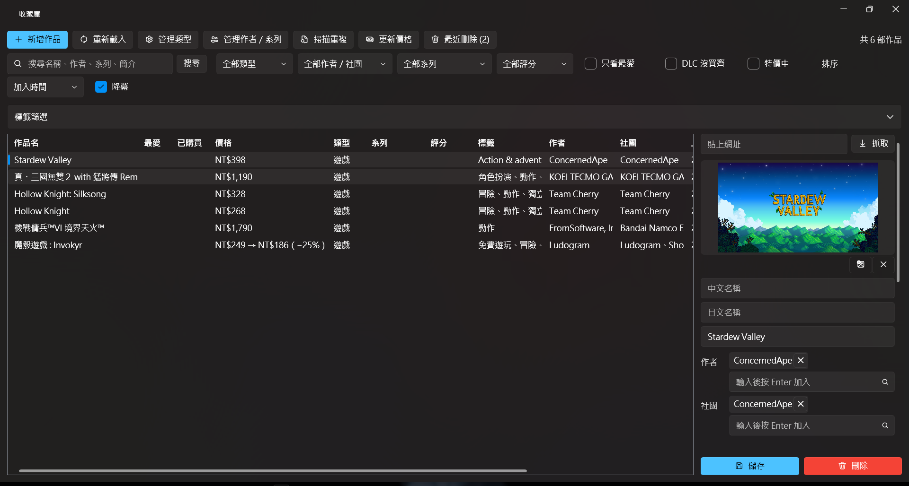
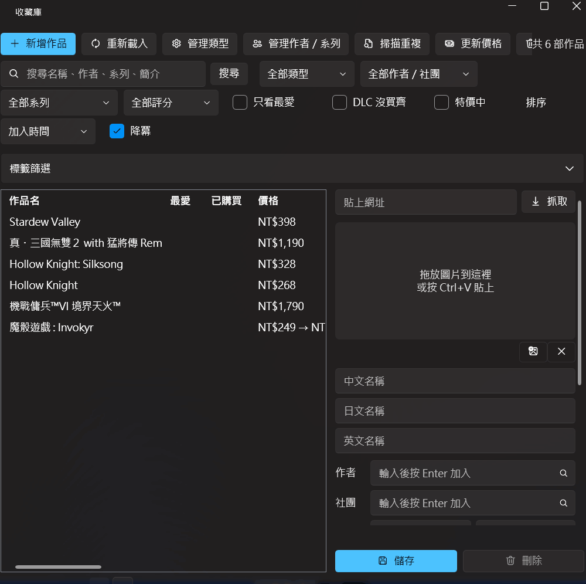
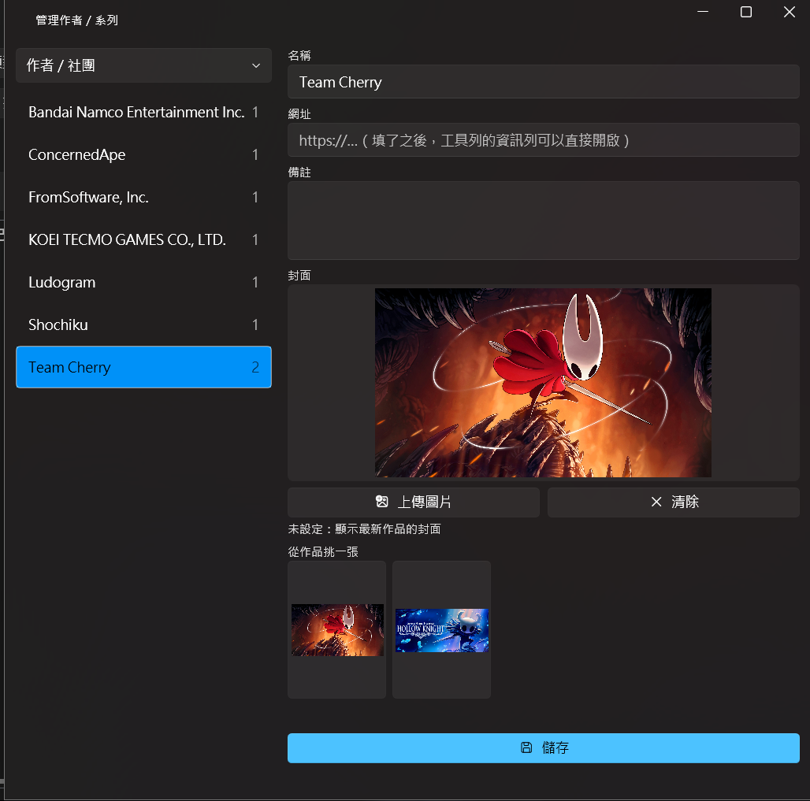
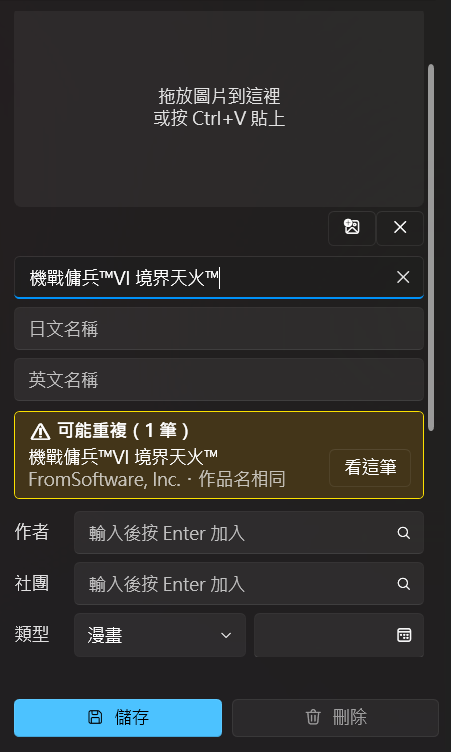
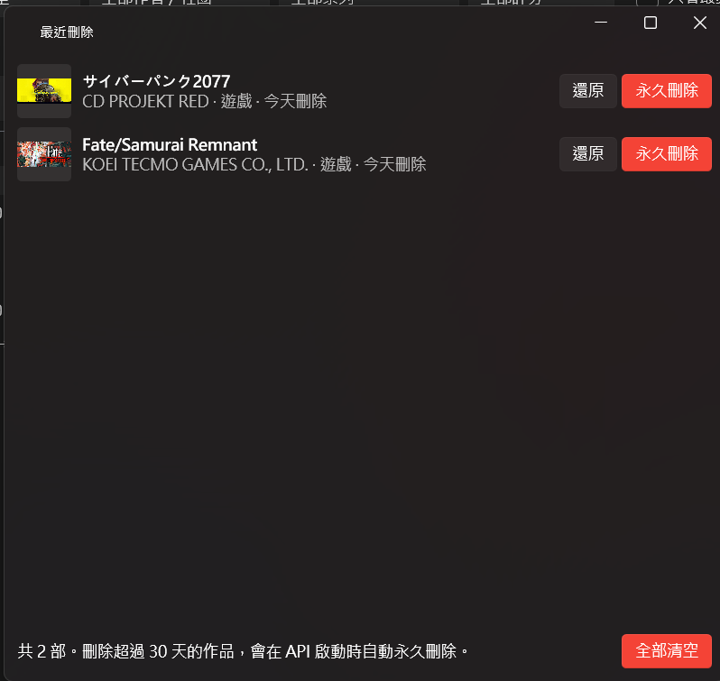

# 收藏庫 Library

管理個人收藏（遊戲、漫畫、動畫、影片等）的 Windows 桌面程式。
後端是 ASP.NET Core Web API，前端是 WPF，資料庫是 SQL Server。



## 功能

### 貼上商店網址，自動填好表單

貼上 Steam 或 Microsoft Store（Xbox／PC）的商品頁網址按「抓取」，會帶入中／日／英名稱、開發商與發行商、發售日、封面、標籤、簡介，以及目前的台幣價格。特價中的作品會一併記下原價與折扣。



### 完整的作品資料

- 中／日／英三種名稱，清單顯示第一個有填的
- 作者與社團、類型、系列、標籤、評分（1～5 星，6 是王冠）、最愛、發售日、簡介
- 一部作品可以有多個商店網址，各自記錄語言、購買狀態與價格；任一網址已購買就算已購買
- DLC／追加內容另外列出，各自記錄購買狀態與價格
- 封面可以選擇檔案、拖放、Ctrl+V 貼上，或從網址下載；上傳前自動縮小

### 找得到想看的作品

- 搜尋名稱、作者、系列、簡介
- 依類型、作者／社團、系列、評分、最愛、「DLC 還沒買齊」、「特價中」篩選
- 依標籤篩選，可以選擇全部符合或任一符合
- 依名稱、發售日、評分、修改時間、加入時間排序

### 價格與特價

- 按「更新價格」，一次重新查詢所有 Steam、Microsoft Store 網址的價格、原價與折扣（每個商店分批查詢，不是一部一部查）
- 清單的價格欄顯示最便宜的網址，特價中顯示「原價 → 現價（−折扣%）」
- 勾選「特價中」，只看目前正在特價的作品

### 作者、社團、系列的頁面

篩選某位作者時，上方會顯示他的網址與備註。作者、社團、系列都可以改名、加上網址、備註與封面；沒有設定封面時，使用最新一部作品的封面。



### 重複偵測

- 輸入名稱或網址時即時檢查：網址相同、或同作者且名稱相同是**完全重複**（紅色），名稱相同但作者不同是**可能重複**（黃色）
- 名稱比對前會統一全形半形、大小寫，並去掉「[漢化]」「(DL版)」這類標記；續作（例如 Portal 和 Portal 2）不算重複
- 完全重複的作品，儲存前要再確認一次
- 也可以掃描整個收藏庫，列出所有重複的組，直接刪除或打開其中一部



### 最近刪除

刪除的作品先放進最近刪除，可以還原或永久刪除；刪除超過 30 天的作品，會在 API 啟動時自動清除。



## 技術

| | |
|---|---|
| 後端 | .NET 10、ASP.NET Core Web API、EF Core 10、SQL Server 2022 |
| 桌面 | WPF、CommunityToolkit.Mvvm、WPF UI |
| 測試 | xUnit、Testcontainers、Respawn |
| 其他 | Docker Compose、GitHub Actions |

```
src/
  Library.Domain           Entity
  Library.Application      業務規則（Service、DTO、驗證），只依賴介面
  Library.Infrastructure   EF Core、Migration、封面儲存、Steam 與 Microsoft Store
  Library.Api              Controller，組裝 DI
  Library.Desktop          WPF（MVVM），透過 HTTP 呼叫 API
tests/
  Library.UnitTests        名稱與網址正規化、驗證、商店回應的解析、封面格式
  Library.IntegrationTests 在 Docker 裡啟動真的 SQL Server 來測試
```

設計重點：
- Application 層只依賴 `ILibraryDbContext`、`ICoverStorage`、`IStoreSource` 這些介面，測試時可以換成假的實作
- 軟刪除使用 EF Core 的全域查詢篩選；最近刪除用 `IgnoreQueryFilters` 取出，永久刪除用 `ExecuteDeleteAsync`，關聯資料交給資料庫的 Cascade
- 時間一律存 UTC，並透過注入的 `TimeProvider` 取得，測試可以控制時間
- 整合測試使用真的 SQL Server：所有測試共用一個已經 Migrate 的資料庫，每個測試開始前用 Respawn 清空，全部約 10 秒
- 商店來源分成兩個介面：`IStoreSource`（抓作品資料）和 `IPriceSource`（批次查價格），新增商店只要多一個實作
- 從網址下載封面時，只允許 http／https，並檢查檔頭與檔案大小
- ViewModel 不直接使用視窗元件，對話框透過 `IDialogService` 注入

## 執行

需要 Windows、[.NET 10 SDK](https://dotnet.microsoft.com/download) 和 Docker Desktop。以下指令都在 repo 的根目錄執行。

**1. 啟動 SQL Server**

把 `.env.example` 複製成 `.env`，修改 `SA_PASSWORD`（至少 8 個字元，包含大小寫英文、數字和符號），再啟動容器：

```bash
docker compose up -d
```

**2. 設定連線字串**

密碼和 `.env` 的 `SA_PASSWORD` 相同。連線字串存在 User Secrets，不會進 git：

```bash
dotnet user-secrets set "ConnectionStrings:Default" "Server=localhost,1433;Database=Library;User Id=sa;Password=你的密碼;TrustServerCertificate=True;" --project src/Library.Api
```

**3. 建立資料表**

執行 `src/Library.Infrastructure/Migrations/` 裡的 Migration，建立所有資料表與預設的作品類型。沒有做這一步的話，API 啟動時會失敗。

```bash
dotnet tool install --global dotnet-ef
dotnet ef database update --project src/Library.Infrastructure --startup-project src/Library.Api
```

之後有新的 Migration 時，再執行一次 `dotnet ef database update` 即可，已經套用的不會重複執行。

**4. 啟動 API 與桌面程式**

各開一個終端機：

```bash
dotnet run --project src/Library.Api --launch-profile http
```

```bash
dotnet run --project src/Library.Desktop
```

API 啟動後，可以在 http://localhost:5265/swagger 看到所有端點。

## 測試

```bash
dotnet test
```

整合測試會用 Testcontainers 自動啟動一個獨立的 SQL Server 容器，需要 Docker Desktop 開著，不會影響第 1 步的資料庫。
